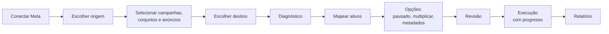
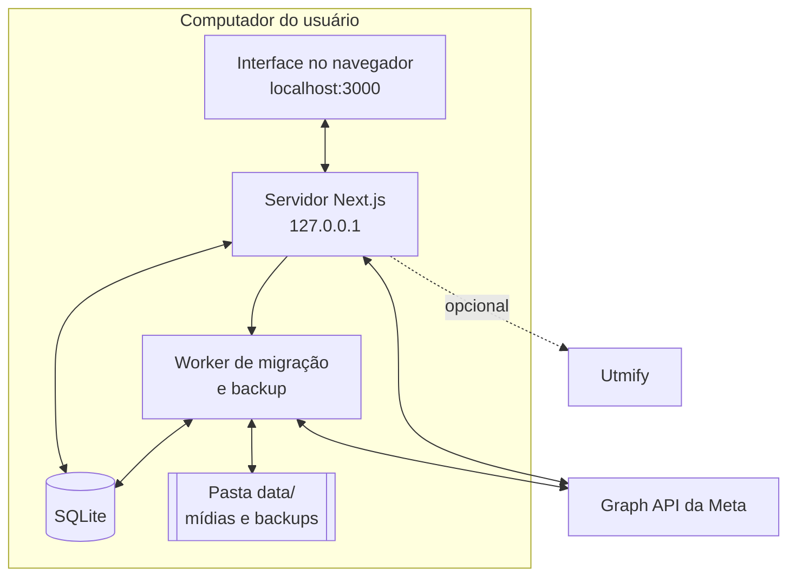

# Migra Ads — Plano de Implementação

> Ferramenta local, gratuita e open source para migrar campanhas, conjuntos e anúncios validados de uma conta de anúncios da Meta para outra, em minutos, com interface visual.
>
> Criado por **Felipe Top** · Instagram e YouTube: **@realfelipetop**

| | |
|---|---|
| **Versão do documento** | 1.1 — 12/11/2026 (status atualizado no fim do dia) |
| **Status** | Fases 0–4 e 6–10 prontas (app v0.9.0). Fase 5 adiada: opcional |
| **Plataformas** | macOS e Windows (Linux de brinde) |
| **Licença** | MIT |
| **Idioma da interface** | Português (BR). Estrutura pronta para traduzir depois, se decidirmos |

---

## Status (12/11/2026, fim do dia)

| Fase | Situação | Observação |
|---|---|---|
| 0 · Validação da API | ✅ | [Resultados](docs/fase-0-resultados.md). Login em localhost ok; reaproveitar post funciona; conta desativada é legível |
| 1 · Fundação | ✅ | Next.js 16 + SQLite; `npm start` multiplataforma; CI em macOS/Windows/Linux (Windows ainda não rodou de verdade) |
| 2 · Conexão com a Meta | ✅ | Login com Facebook, token criptografado, prazo de 90 dias do acesso aos dados |
| 3 · Explorador | ✅ | Números conferidos com o Gerenciador |
| 4 · Motor de migração | ✅ | Testado na Meta real: 26 criados + 2 manuais; app derrubado no meio e retomado (o duplicado encontrado virou correção + teste) |
| 5 · Criativos com mídia | ⏸️ Adiada | A Meta só aceita criativo novo com o app **publicado**. Decisão: publicar não é obrigatório; esses anúncios viram "migrar manualmente". Fica como recurso opcional futuro |
| 6 · Diagnóstico e BM → BM | ✅ | Mapeamento de pixel/conversão/públicos/Instagram e moeda; testado até a revisão com conta de outra BM |
| 7 · Multiplicar e relatórios | ✅ | Cópias [C1..Cn]; CSV. Multiplicar ainda não foi executado na Meta real |
| 8 · Backup automático | ✅ | Backup real com 12 imagens e 12 vídeos; agendador conferido; migrar a partir de backup |
| 9 · Utmify | ✅ (parcial) | A API oficial só traz o resumo da conta (sem métricas por campanha) e está em beta para alguns planos. Feito: card de resultado real + "Selecionar vencedores" pelas métricas da Meta |
| 10 · Open source | ✅ (local) | README, guias, CLAUDE.md, CONTRIBUTING, SECURITY e [checklist de publicação](docs/PUBLICAR.md). **Não publicado**: o histórico do Git tem dados reais, publicar como repositório novo |

**Mudanças de plano em relação ao texto abaixo:** a ordem foi 0–4, 7, 6, 8, 9, 10 (a 5 foi adiada); o `id_map` passou a ser por migração; o diagnóstico de página usa a permissão ADVERTISE do usuário (não `promote_pages`); TanStack Table não foi usado (tabela própria).

---

## Sumário

1. [O problema e o objetivo](#1-o-problema-e-o-objetivo)
2. [Princípios do produto](#2-princípios-do-produto)
3. [Escopo da v1](#3-escopo-da-v1)
4. [Como a migração funciona](#4-como-a-migração-funciona)
5. [Arquitetura técnica](#5-arquitetura-técnica)
6. [Conexão com a Meta](#6-conexão-com-a-meta)
7. [Mapeamento de objetos da Meta](#7-mapeamento-de-objetos-da-meta)
8. [Motor de migração](#8-motor-de-migração)
9. [Diagnóstico da conta de destino](#9-diagnóstico-da-conta-de-destino)
10. [Funcionalidades complementares](#10-funcionalidades-complementares)
11. [Telas e experiência](#11-telas-e-experiência)
12. [Design](#12-design)
13. [Banco de dados local](#13-banco-de-dados-local)
14. [Roadmap por fases](#14-roadmap-por-fases)
15. [Testes e qualidade](#15-testes-e-qualidade)
16. [Segurança e privacidade](#16-segurança-e-privacidade)
17. [Riscos e mitigação](#17-riscos-e-mitigação)
18. [Fora do escopo da v1](#18-fora-do-escopo-da-v1)
19. [A validar na Fase 0](#19-a-validar-na-fase-0)
20. [Glossário](#20-glossário)

---

## 1. O problema e o objetivo

Quem roda tráfego pago na Meta está sujeito a ter uma conta de anúncios restrita ou em análise, muitas vezes por falha da própria plataforma: login de outro dispositivo, viagem, revisão automática errada. Até a conta voltar, a operação para. Hoje, a única saída é **recriar tudo à mão** em outra conta: campanhas, conjuntos, dezenas de anúncios, textos, links, UTMs, pixel, lances. Isso leva horas e mobiliza a equipe.

**Objetivo do Migra Ads:** transformar essas horas em minutos. A pessoa escolhe o que quer levar, escolhe o destino, revisa e clica em migrar.

**Caso principal (≈90% dos casos):** conta de anúncios → outra conta de anúncios **da mesma BM**. Página, Instagram, WhatsApp, pixel e formulários já estão compartilhados, então a migração é quase só recriar a estrutura.

**Caso secundário:** BM → outra BM. Funciona, mas depende do acesso a pixel, página e públicos no destino. O app diagnostica isso e mostra o que falta.

### O que o Migra Ads não é

- **Não** é uma ferramenta para burlar restrições por violação de política. Se a conta caiu por anúncio irregular, levar o mesmo anúncio para outra conta tende a derrubar a nova também. O app vai deixar isso claro (ver [§10.5](#105-aviso-sobre-restrições)).
- **Não** garante performance: tudo nasce com ID novo e passa de novo pela fase de aprendizado.
- **Não** é um serviço web. Roda 100% no computador de quem usa.

---

## 2. Princípios do produto

1. **Local e privado.** Nenhum dado sai do computador, a não ser para a própria API da Meta (e para a Utmify, se a pessoa ativar).
2. **Seguro por padrão.** Tudo é criado **pausado**. Nada é publicado sem uma tela de revisão antes.
3. **Nunca duplica sem querer.** Se a migração cair no meio, ela continua de onde parou.
4. **Fala a língua do gestor de tráfego.** Interface parecida com o Gerenciador de Anúncios, erros da Meta traduzidos para português claro.
5. **Honesto.** Quando algo não pode ser copiado, o app avisa e explica, em vez de falhar em silêncio ou fingir que deu certo.
6. **Fácil de instalar.** `git clone`, um comando, e abre no navegador. Funciona em Mac e Windows.

---

## 3. Escopo da v1

### Entra na v1

| # | Funcionalidade | Descrição |
|---|---|---|
| 1 | Conexão com a Meta | Login com Facebook e assistente passo a passo. Lista contas pessoais, BMs, grupos de ativos e contas compartilhadas |
| 2 | Explorador da origem | Abas Campanhas / Conjuntos / Anúncios, com miniaturas, status, métricas do período e seleção por checkbox |
| 3 | Migração conta → conta | Recria campanha, conjuntos e anúncios no destino com todas as configurações copiáveis |
| 4 | Reaproveitar publicação existente | Anúncios de "publicação existente" usam o mesmo post no destino (mantém a prova social) |
| 5 | Cópia de criativos | Imagens e vídeos enviados direto na conta são copiados para a conta de destino |
| 6 | Diagnóstico do destino | Checklist: conta ativa, pagamento, moeda, fuso, pixel, página, Instagram, WhatsApp, formulários, públicos |
| 7 | Mapeamento de ativos | Trocar pixel, página, Instagram e públicos da origem pelos equivalentes no destino |
| 8 | Revisão antes de executar | Mostra tudo que será criado, com avisos, antes de qualquer chamada de escrita |
| 9 | Criar pausado (padrão) | Opção de criar já ativo |
| 10 | Modo multiplicar | Migrar e criar N cópias da campanha, com sufixo no nome |
| 11 | Retomar após erro | Continua do ponto em que parou, sem duplicar |
| 12 | Relatório final | O que foi criado, links diretos para o Gerenciador, o que precisa de ação manual |
| 13 | Backup automático (opcional) | Toggle. Salva estrutura e criativos das contas escolhidas com a frequência escolhida |
| 14 | Remover metadados (opcional) | Remove localização, dispositivo e software de edição dos arquivos antes de subir. É um recurso de **privacidade** |
| 15 | Integração Utmify (opcional) | Mostra lucro, ROAS e CPA reais na hora de escolher o que migrar |
| 16 | Guia "Estrutura recomendada" | Explica o modelo de BM mãe |
| 17 | Marca do autor | Tela "Sobre" e rodapé com Instagram e YouTube @realfelipetop |

### Tipos de campanha suportados na v1

| Tipo | Suporte | Observação |
|---|---|---|
| Vendas no site (pixel) | ✅ Completo | Seu caso principal: CBO, bid cap, 1 conjunto, vários anúncios |
| Vendas / mensagens no WhatsApp | ✅ Completo | Número precisa estar ligado à página no destino |
| Formulário de leads | ✅ Completo | Formulário pertence à página: mesma página, mesmo formulário |
| Tráfego, engajamento, reconhecimento | ✅ Completo | Mais simples que vendas |
| Campanhas Advantage+ | ✅ Com validação | A Meta muda essa API com frequência. Validar na Fase 0 |
| Catálogo / Advantage+ catálogo | ⏳ Depois da v1 | Exige compartilhamento de catálogo |
| Teste A/B | ❌ Não migra | Os anúncios migram, o teste não |

---

## 4. Como a migração funciona



### Como o computador serve de ponte

A Meta não oferece um botão de "copiar para outra BM". O app faz isso em três passos:

1. **Lê** a estrutura completa da origem pela API: campanha, conjuntos, anúncios, criativos e configurações.
2. **Traduz** a estrutura para o destino, trocando IDs de pixel, página, públicos e mídias.
3. **Cria** na ordem certa: campanha → conjuntos → criativos → anúncios.

Para os criativos, existem três caminhos. O app escolhe automaticamente o melhor:

| Caminho | Quando usa | O que acontece |
|---|---|---|
| **A. Mesmo post** | Anúncio de "publicação existente" e a página está acessível no destino | Cria um criativo no destino apontando para o mesmo post. Sem download. Mantém curtidas e comentários |
| **B. Cópia direta** | Imagem ou vídeo enviado na conta | Pede à Meta para copiar a mídia de uma conta para outra, sem passar pelo computador (validar na Fase 0) |
| **C. Download + upload** | O caminho B falha, ou "remover metadados" está ligado | Baixa o arquivo para o computador, opcionalmente limpa os metadados, e sobe na conta de destino |

---

## 5. Arquitetura técnica

### 5.1 Stack

| Camada | Escolha | Por quê |
|---|---|---|
| Linguagem | **TypeScript** | Um idioma só no front e no back, com tipos para os objetos da Meta |
| App | **Next.js (App Router)** rodando local | Interface e servidor no mesmo projeto, um comando para iniciar |
| Interface | **Tailwind CSS + shadcn/ui** | Componentes prontos e fáceis de deixar com cara de Gerenciador |
| Tabelas | **TanStack Table** | Tabelas grandes com seleção, ordenação e colunas, como no Gerenciador |
| Dados no front | **TanStack Query** | Cache e atualização das listas da Meta |
| Validação | **Zod** | Valida as respostas da Meta e os formulários |
| Banco local | **SQLite** (better-sqlite3) + **Drizzle ORM** | Um arquivo só, sem instalar banco, funciona em Mac e Windows |
| Tarefas em segundo plano | Fila própria guardada no SQLite + worker no processo do Node | Sem Redis nem serviços extras |
| Progresso em tempo real | **Server-Sent Events** | A tela de execução atualiza sozinha |
| Imagens | **sharp** | Remove metadados de imagens |
| Vídeos | **ffmpeg-static** | Remove metadados de vídeo **sem recodificar** (`-map_metadata -1 -c copy`). Já traz o ffmpeg para Mac e Windows |
| Agendamento | **node-cron** | Backup automático enquanto o app está aberto |
| Testes | **Vitest**, **MSW** (simula a API da Meta), **Playwright** (telas) | |
| CI | **GitHub Actions** em macOS, Windows e Linux | Garante que instala e roda nos três |

**Requisito para usar:** Node.js 20 LTS ou mais novo. Só isso.

### 5.2 Como a pessoa instala e roda

```bash
git clone https://github.com/<usuario>/migra-ads.git
cd migra-ads
npm install
npm start
```

O `npm start` faz o build na primeira vez, sobe o servidor **somente em `127.0.0.1`** (ninguém da rede acessa) e abre o navegador em `http://localhost:3000`.

### 5.3 Estrutura de pastas

```
migra-ads/
├── app/                        # Telas e rotas de API (Next.js)
│   ├── (onboarding)/conectar/
│   ├── origem/
│   ├── migracao/[id]/          # destino, diagnóstico, mapeamento, revisão, execução, relatório
│   ├── backups/
│   ├── configuracoes/
│   ├── sobre/
│   └── api/
│       ├── auth/               # login com Facebook (OAuth) e callback
│       ├── meta/               # leitura de contas, campanhas etc.
│       ├── migrations/         # criar, executar, pausar, retomar
│       └── events/             # SSE de progresso
├── src/
│   ├── meta/                   # Cliente da Graph API
│   │   ├── client.ts           # requisições, paginação, lotes, versão da API
│   │   ├── fields.ts           # campos lidos de cada objeto
│   │   ├── errors.ts           # erros da Meta → mensagens em português
│   │   └── rate-limit.ts       # respeita os limites de uso
│   ├── migration/
│   │   ├── reader.ts           # lê a árvore da origem (snapshot)
│   │   ├── planner.ts          # monta o plano (simulação)
│   │   ├── mapper.ts           # traduz campos e IDs para o destino
│   │   ├── executor.ts         # executa passo a passo, com retomada
│   │   └── id-map.ts           # origem → destino, para não duplicar
│   ├── creatives/
│   │   ├── strategy.ts         # escolhe o caminho A, B ou C
│   │   ├── download.ts
│   │   ├── upload.ts
│   │   └── metadata.ts         # limpeza de metadados (sharp / ffmpeg)
│   ├── diagnostics/            # checklist do destino
│   ├── backup/                 # agendador e snapshots
│   ├── integrations/utmify/
│   ├── db/                     # schema Drizzle e migrações
│   ├── i18n/                   # textos da interface (pt-BR)
│   └── config/
│       └── brand.ts            # nome, @, links do autor
├── components/                 # componentes de interface
├── data/                       # (fora do Git) banco, mídias, backups, chave
├── docs/                       # guias com prints: criar app na Meta, BM mãe
├── CLAUDE.md                   # contexto para quem quiser usar o Claude Code no projeto
├── README.md
└── LICENSE
```

### 5.4 Visão geral



---

## 6. Conexão com a Meta

### 6.1 Por que login com Facebook (token de usuário)

Os prints mostraram que a conta usada hoje é **pessoal** (não está dentro de uma BM). O token de **usuário do sistema** só enxerga ativos de BM, então ele não serve como conexão principal.

Com o **login com Facebook**, um único login lista tudo que aparece no seletor de contas do Gerenciador:
- contas pessoais ("A tua conta");
- todas as BMs (portfólios de negócios);
- grupos de ativos;
- contas compartilhadas por outra BM (ex.: a "CA2", que pertence à BM Clientes e aparece dentro da BM Principal).

| Modo | Para quem | Validade |
|---|---|---|
| **Login com Facebook** (recomendado) | Todo mundo | ~60 dias. O app avisa 7 dias antes e oferece "reconectar" |
| **Colar token** (avançado) | Quem já tem token de usuário do sistema ou do Graph API Explorer | Depende do token. O de sistema não expira |

### 6.2 O app da Meta de cada usuário

Como o projeto é open source, **cada pessoa cria o próprio app** no Meta for Developers. Assim não existe servidor central, nem revisão de app pela Meta, nem limite compartilhado entre usuários.

- O app fica em **modo de desenvolvimento**. Nesse modo, quem é admin do app (a própria pessoa) pode usar todas as permissões sem passar por revisão da Meta.
- O redirecionamento do login aponta para `http://localhost:3000/api/auth/callback` (validar na Fase 0).
- Permissões pedidas: `ads_management`, `ads_read`, `business_management`, `pages_show_list`, `pages_read_engagement`, `pages_manage_ads`, `instagram_basic`, `leads_retrieval` (para validar formulários) e `whatsapp_business_management` (se necessário, validar na Fase 0).

### 6.3 Assistente de conexão (o ponto mais crítico da experiência)

Se essa parte ficar confusa, a pessoa desiste antes de usar. Então:

1. Tela explicando o que vai acontecer e por que (com prints).
2. Botão que abre o Meta for Developers na página certa.
3. Passo a passo com prints: criar app → adicionar "Marketing API" e "Login do Facebook" → copiar App ID e App Secret.
4. Campos para colar App ID e App Secret, com validação na hora.
5. Botão "Entrar com Facebook".
6. Teste automático: lista as contas encontradas e confirma "Conectado ✔".

O guia também existe em `docs/conectar-meta.md`, com os mesmos prints.

---

## 7. Mapeamento de objetos da Meta

Cada campo lido da origem cai em uma de quatro categorias:

| Categoria | O que o app faz |
|---|---|
| **Copiar** | Vai igual para o destino |
| **Remapear** | É um ID que pertence à origem e precisa ser trocado pelo equivalente no destino |
| **Descartar** | Só leitura ou gerado pela Meta (ID, status de entrega, data de criação, recomendações) |
| **Perguntar** | Precisa de decisão do usuário (moeda diferente, público inexistente no destino) |

### 7.1 Campanha

| Campo | Categoria | Observação |
|---|---|---|
| `name` | Copiar | Com sufixo opcional (ex.: ` [MIGRA]`, ` [C2]`) |
| `objective` | Copiar | |
| `special_ad_categories` | Copiar | |
| `buying_type` | Copiar | |
| `bid_strategy` | Copiar | Ex.: limite de lance (bid cap) |
| `daily_budget` / `lifetime_budget` | Copiar ou perguntar | Pergunta se a moeda do destino for diferente |
| `spend_cap` | Copiar | |
| Configurações Advantage+ da campanha | Copiar com validação | Ver [§19](#19-a-validar-na-fase-0) |
| `status` | Regra do app | `PAUSED` por padrão |

### 7.2 Conjunto de anúncios

| Campo | Categoria | Observação |
|---|---|---|
| `name`, `optimization_goal`, `billing_event`, `destination_type` | Copiar | |
| `bid_amount`, `bid_strategy` | Copiar | Valor em centavos da moeda da conta |
| `daily_budget` / `lifetime_budget` | Copiar ou perguntar | Só existe quando o orçamento é no conjunto |
| `targeting` | Copiar + remapear | Públicos personalizados e semelhantes são remapeados |
| `promoted_object` | Remapear | `pixel_id`, `custom_event_type`, conversão personalizada, `page_id`, número do WhatsApp |
| `attribution_spec` | Copiar | Ex.: clique em 7 dias |
| `start_time` / `end_time` | Perguntar | Datas no passado são trocadas por "agora" |
| Advantage+ público / posicionamentos | Copiar | |

### 7.3 Criativo e anúncio

| Campo | Categoria | Observação |
|---|---|---|
| `object_story_id` (publicação existente) | Remapear (caminho A) | Mesmo post, desde que a página esteja acessível no destino |
| `object_story_spec` | Copiar + remapear | Texto, título, descrição, link, CTA, página, Instagram |
| `image_hash` / `video_id` | Remapear (caminho B ou C) | A mídia é copiada para a conta de destino |
| `asset_feed_spec` | Copiar + remapear | Várias mídias e textos, e proporções por posicionamento |
| `degrees_of_freedom_spec` (melhorias Advantage+) | Copiar com validação | Se alguma melhoria for recusada, cria sem ela e avisa |
| Anúncio de vários anunciantes | Copiar | |
| Anúncio em parceria | Copiar | Depende da parceria valer no destino |
| CTA "Ligar agora" / WhatsApp / formulário | Copiar + remapear | O formulário é da página |
| `url_tags` (UTMs) | Copiar | |
| `tracking_specs` (monitorização do pixel) | Remapear | Pixel da origem → pixel do destino |
| Status "reprovado" na origem | Perguntar | Por padrão, o anúncio reprovado fica **desmarcado** |

---

## 8. Motor de migração

### 8.1 Etapas

1. **Snapshot da origem.** Lê tudo de uma vez (em lote) e salva no SQLite. A partir daqui, a migração não depende mais da conta de origem continuar acessível.
2. **Plano (simulação).** Gera a lista exata de objetos a criar, com os campos já traduzidos, e os avisos. Nada é escrito na Meta.
3. **Execução**, na ordem campanha → conjuntos → mídias → criativos → anúncios.
4. **Relatório.**

### 8.2 Retomar sem duplicar

Cada item do plano vira uma linha na tabela `migration_items`, com o ID de origem, o ID criado no destino e o status. Antes de criar qualquer coisa, o executor consulta o `id_map`:

- já criado → pula;
- falhou → tenta de novo (até 3 vezes, com espera crescente);
- erro permanente (permissão, validação) → marca como "precisa de ação" e segue com os outros.

Se a internet cair ou o app fechar no anúncio 31 de 40, o botão **Retomar** continua do 31.

### 8.3 Limites da API

- Leituras em **lote** (até 50 requisições por chamada) e paginação automática.
- O app lê os cabeçalhos de uso que a Meta devolve e **desacelera sozinho** antes de bater no limite.
- Na tela, um aviso honesto: "migrações grandes podem levar alguns minutos".

### 8.4 Erros em português

`src/meta/errors.ts` traduz os erros mais comuns da Meta. Exemplos:

| Erro da Meta | Mensagem no app |
|---|---|
| Permissão no pixel | "A conta de destino não tem acesso ao pixel MINHALOJA. Compartilhe o pixel com essa conta na BM ou escolha outro pixel." |
| Conta sem pagamento | "A conta de destino não tem forma de pagamento. Os anúncios foram criados, mas não vão rodar até você adicionar uma." |
| Token expirado | "Sua conexão com a Meta expirou. Clique em Reconectar — a migração continua de onde parou." |
| Limite de uso | "A Meta pediu para irmos mais devagar. Continuando automaticamente em 2 minutos…" |

### 8.5 Modo multiplicar

Na tela de opções: **"Criar cópias: [ 1 ]"** e **"Sufixo: [C{n}]"**. Com 3 cópias, por exemplo, o app cria `MINHA LOJA - VENDAS [C1]`, `[C2]` e `[C3]`. As mídias são copiadas uma vez só e reaproveitadas em todas as cópias.

### 8.6 Moeda e fuso horário

- **Moeda diferente:** o app **não converte sozinho**. Ele mostra os valores da origem e pede os novos, sugerindo uma conversão.
- **Fuso diferente:** horários de início e fim são ajustados e mostrados na revisão.

---

## 9. Diagnóstico da conta de destino

Roda antes da revisão. Cada item fica **verde** (ok), **amarelo** (funciona, mas atenção) ou **vermelho** (impede a migração ou a entrega).

| Verificação | Vermelho quando | Como resolver (mostrado no app) |
|---|---|---|
| Conta ativa | Conta desativada ou em análise | Escolher outra conta |
| Forma de pagamento | Sem pagamento (amarelo: cria, mas não roda) | Link para as configurações de pagamento |
| Moeda | Diferente da origem (amarelo) | Informar os novos valores |
| Fuso horário | Diferente (amarelo) | Informativo |
| Pixel | Destino sem acesso ao pixel usado | Compartilhar o pixel ou mapear para outro |
| Conversões personalizadas | Não existem no destino | Mapear ou recriar |
| Página | Destino não pode anunciar pela página | Atribuir a página à conta |
| Instagram | Conta do Instagram não ligada | Ligar ou anunciar só pela página |
| WhatsApp | Número não ligado à página | Instruções |
| Formulários | Página diferente | Usar a mesma página ou escolher outro formulário |
| Públicos personalizados | Público não compartilhado | Compartilhar, mapear ou remover do conjunto |
| Domínio | Domínio do link não verificado na BM de destino (amarelo) | Instruções |
| Limite de gastos | Limite da conta abaixo do orçamento (amarelo) | Informativo |

---

## 10. Funcionalidades complementares

### 10.1 Backup automático (opcional)

- **Toggle** por conta de anúncios, na tela de Backups.
- Frequência: a cada 6 h, 12 h ou 24 h.
- Escopo: só campanhas ativas, ou ativas + pausadas dos últimos X dias.
- Opção "baixar também as mídias", que ocupa mais espaço.
- Retenção: guardar os últimos N backups.
- Salvo em `data/backups/<conta>/<data>/` (estrutura em JSON + mídias).
- **Qualquer backup pode virar origem de uma migração**, mesmo que a conta original tenha caído.
- Aviso claro: "o backup só roda com o computador ligado e o Migra Ads aberto".

### 10.2 Remover metadados (opcional, privacidade)

- Remove de imagens e vídeos: localização (GPS), modelo do aparelho, datas, software de edição e nome do autor.
- Imagens: `sharp`. Vídeos: `ffmpeg` **sem recodificar**, ou seja, sem perda de qualidade.
- Só se aplica a anúncios que precisam de upload (caminho C). Anúncios de publicação existente não têm arquivo.
- **O texto da interface descreve o recurso como privacidade.** Ele não altera o conteúdo do criativo e não promete evitar bloqueio, porque não faz isso.

### 10.3 Integração Utmify (opcional)

- Em Configurações: campo para conectar a Utmify e escolher o dashboard.
- No Explorador, aparecem colunas extras de **lucro, ROAS e CPA reais** por campanha, conjunto e anúncio, com o botão "Selecionar os vencedores".
- Sem a Utmify, o Explorador mostra as métricas da própria Meta (gasto, compras, custo por compra, ROAS).
- A forma de conexão (API pública com token) será validada na Fase 0.

### 10.4 Guia "Estrutura recomendada" (BM mãe)

Tela e documento explicando o modelo:
- **BM mãe:** guarda pixel, página, Instagram, domínio e catálogo. Não roda anúncio.
- **BMs e contas de anúncio:** recebem os ativos compartilhados pela BM mãe.
- Benefício: se uma conta ou BM de anúncio cair, os ativos continuam seguros e a migração fica no caso fácil.

### 10.5 Aviso sobre restrições

Quando a conta de origem estiver restrita, o app mostra o motivo informado pela Meta (quando disponível) e um aviso curto:

> "Se a restrição foi por falha ou análise automática, migrar é seguro. Se foi por violação de política, corrija o anúncio antes de migrar: a Meta liga as contas pelo conteúdo, pela página e pelo domínio."

### 10.6 Marca do autor

- Arquivo `src/config/brand.ts`:
  ```ts
  export const BRAND = {
    appName: "Migra Ads",
    author: "Felipe Top",
    instagram: "https://instagram.com/realfelipetop",
    youtube: "https://youtube.com/@realfelipetop",
  };
  ```
- **Rodapé** em todas as telas: "Feito por Felipe Top · Instagram · YouTube".
- **Tela Sobre**, com foto, bio curta e os links.
- **README** com a mesma seção.

---

## 11. Telas e experiência

### 11.1 Mapa de telas

| # | Tela | Função |
|---|---|---|
| 1 | Conectar Meta | Assistente de primeira vez |
| 2 | Início | Contas conectadas, migrações recentes, status dos backups |
| 3 | Escolher origem | Seletor no estilo do Gerenciador: BMs à esquerda, contas à direita, busca no topo |
| 4 | Explorador | Abas Campanhas / Conjuntos / Anúncios, miniaturas, métricas, filtros, checkbox |
| 5 | Escolher destino | Mesmo seletor da origem |
| 6 | Diagnóstico | Checklist verde/amarelo/vermelho com "como resolver" |
| 7 | Mapeamento | Pixel → pixel, página → página, públicos, conversões |
| 8 | Opções | Pausado/ativo, cópias, sufixo, remover metadados, orçamento |
| 9 | Revisão | Árvore do que será criado, contadores, avisos, botão "Migrar" |
| 10 | Execução | Barra de progresso, item atual, log, botões Pausar/Retomar |
| 11 | Relatório | Criados, pulados, com erro; links para o Gerenciador; exportar |
| 12 | Backups | Toggles, histórico, "migrar a partir deste backup" |
| 13 | Configurações | Conexão Meta, Utmify, pasta de dados, idioma |
| 14 | Sobre | Autor, links, versão, licença |
| 15 | Estrutura recomendada | Guia da BM mãe |

### 11.2 Explorador (tela principal)

```
┌──────────────────────────────────────────────────────────────────────────────┐
│ ◧ Migra Ads   Origem: [▣ 111111111111111 · Minha conta pessoal  ▾]   Período: [30 dias ▾] │
├──────────────────────────────────────────────────────────────────────────────┤
│ [■ Campanhas  1 selecionada ×]  [▦ Conjuntos]  [▢ Anúncios]                     │
│ Filtros: (•) Ativos  ( ) Todos   ☐ Esconder reprovados   🔍 Buscar…            │
├───┬────────────────────────────────────┬──────────┬────────┬──────────┬────────┤
│ ☑ │ Campanha                           │ Status   │ Compras│ Custo/res│ Gasto  │
├───┼────────────────────────────────────┼──────────┼────────┼──────────┼────────┤
│ ☑ │ MINHA LOJA - VENDAS - PRODUTO X     │ ● Ativa  │   114  │ R$ 48,57 │ R$5.537│
│ ☐ │ MINHA LOJA - VENDAS - BIDCAP - …  │ ○ Desat. │    12  │ R$ 69,94 │ R$ 839 │
├───┴────────────────────────────────────┴──────────┴────────┴──────────┴────────┤
│ 1 campanha · 1 conjunto · 31 anúncios (1 reprovado desmarcado)  [ Migrar → ]   │
└──────────────────────────────────────────────────────────────────────────────┘
  Feito por Felipe Top · Instagram · YouTube
```

- Selecionar uma campanha marca automaticamente todos os conjuntos e anúncios dela. Dá para desmarcar um por um.
- Selecionar só alguns anúncios cria a campanha e o conjunto "pai" no destino com eles dentro.

### 11.3 Revisão

```
┌─────────────────────────── Revisão da migração ──────────────────────────────┐
│ Origem: 111111111111111   →   Destino: 333333333333333 (BM Principal)                │
│                                                                              │
│ Será criado (PAUSADO):                                                       │
│  ▸ 1 campanha    MINHA LOJA - VENDAS - PRODUTO X [MIGRA]   CBO R$ 182/dia     │
│    ▸ 1 conjunto  CONJ1 - ABERTO   bid cap · pixel MINHALOJA · 7d clique    │
│      ▸ 31 anúncios   27 mesmo post · 4 com upload de mídia                   │
│                                                                              │
│ ⚠ 2 avisos                                                                   │
│   • A conta de destino não tem forma de pagamento.                           │
│   • 1 melhoria Advantage+ pode não ser aceita; o anúncio será criado sem ela.│
│                                                                              │
│              [ ← Voltar ]                       [ Migrar agora ]             │
└──────────────────────────────────────────────────────────────────────────────┘
```

---

## 12. Design

**Direção:** familiar para quem usa o Gerenciador de Anúncios (azul e branco, tabelas densas, abas, status com bolinha), mas com **identidade própria**: logo, nome e ícones do Migra Ads. **Sem logo, nome ou ícones da Meta.**

| Token | Claro | Escuro | Uso |
|---|---|---|---|
| `--primary` | `#1D6FE0` | `#4C8DF0` | Botões principais, links, aba ativa |
| `--primary-soft` | `#E8F1FD` | `#18273D` | Linha selecionada, chips |
| `--bg` | `#F4F6F9` | `#111418` | Fundo da página |
| `--surface` | `#FFFFFF` | `#1A1E24` | Cards e tabelas |
| `--border` | `#DDE1E7` | `#2B313A` | Divisórias |
| `--text` | `#1C1E21` | `#E6E9ED` | Texto |
| `--muted` | `#606770` | `#9AA3AE` | Texto secundário |
| `--success` | `#1E9E5A` | `#3CC27A` | Ativo, diagnóstico ok |
| `--warning` | `#D98B00` | `#F0A82E` | Avisos |
| `--danger` | `#D93A3A` | `#F06262` | Erros, reprovado |

- **Fonte:** Inter.
- **Densidade:** linhas de tabela compactas (~44 px), como no Gerenciador.
- **Tema escuro** automático, seguindo o sistema.
- **Responsivo:** pensado para desktop. Em tela pequena funciona, mas não é prioridade.

---

## 13. Banco de dados local

Arquivo único: `data/migra-ads.db`.

| Tabela | Conteúdo |
|---|---|
| `settings` | Preferências, App ID, caminho dos dados |
| `connections` | Conexão Meta: token **criptografado**, tipo, data de expiração, usuário |
| `accounts_cache` | BMs, contas, páginas, pixels (cache para telas rápidas) |
| `snapshots` | Estrutura completa lida da origem (JSON) |
| `migrations` | Uma migração: origem, destino, opções, status, datas |
| `migration_items` | Cada objeto a criar: nível, ID origem, ID destino, status, tentativas, erro |
| `id_map` | Origem → destino, por conta de destino (base da retomada) |
| `media` | Mídias: hash de origem, arquivo local, hash/ID por conta de destino |
| `asset_mappings` | Mapeamentos salvos (ex.: "pixel X → pixel Y nessa conta"), reaproveitados nas próximas migrações |
| `backup_jobs` / `backups` | Configuração e histórico dos backups |
| `logs` | Registro técnico de chamadas (sem token) para diagnosticar problemas |

---

## 14. Roadmap por fases

Cada fase termina com algo **funcionando e testável**. As fases seguem a ordem do caso mais comum para o mais raro.

### Fase 0 — Validação da API (spike)

Antes de construir a interface, provar com scripts e com as **suas contas reais** que cada peça funciona.

- [ ] Criar o app de desenvolvedor na Meta (você, guiado por mim) e confirmar o login com redirecionamento para `localhost`
- [ ] Ler a árvore completa da campanha `MINHA LOJA - VENDAS - PRODUTO X` (campanha, conjunto, 32 anúncios e criativos)
- [ ] Recriar essa campanha **pausada** em outra conta da mesma BM, com anúncios de publicação existente
- [ ] Testar a cópia direta de imagem e de vídeo entre contas (caminho B)
- [ ] Testar o download e upload de vídeo (caminho C)
- [ ] Testar a cópia das melhorias Advantage+, do anúncio de vários anunciantes e das proporções por posicionamento
- [ ] Confirmar se dá para **ler** uma conta desativada
- [ ] Confirmar a forma de integrar com a Utmify
- [ ] Verificar se o próprio Gerenciador já duplica entre contas, e onde ele falha (para o README)
- [ ] Definir a versão da Graph API

**Pronto quando:** um script recria sua campanha real em outra conta, pausada, e ela fica idêntica no Gerenciador. Os resultados vão para `docs/fase-0-resultados.md`.

### Fase 1 — Fundação

- [ ] Projeto Next.js + TypeScript + Tailwind + shadcn/ui
- [ ] SQLite + Drizzle, com as tabelas da [§13](#13-banco-de-dados-local)
- [ ] Layout base: barra lateral, topo, rodapé com a marca, tema claro e escuro
- [ ] `npm start` que faz build, sobe em `127.0.0.1` e abre o navegador
- [ ] CI no GitHub Actions rodando em macOS, Windows e Linux
- [ ] `.gitignore` protegendo `data/` e `.env`

**Pronto quando:** `git clone` + `npm install` + `npm start` abre o app vazio no Mac **e** no Windows.

### Fase 2 — Conexão com a Meta

- [ ] Assistente de conexão com prints
- [ ] Login com Facebook (OAuth) e troca por token de longa duração
- [ ] Modo avançado: colar token
- [ ] Token criptografado no banco
- [ ] Listar contas pessoais, BMs, grupos de ativos e contas compartilhadas
- [ ] Aviso de expiração e botão "Reconectar"

**Pronto quando:** o seletor do app mostra as mesmas BMs e contas que o seletor do Gerenciador.

### Fase 3 — Explorador da origem

- [ ] Seletor de origem no estilo do Gerenciador
- [ ] Tabelas de campanhas, conjuntos e anúncios, com miniaturas
- [ ] Métricas do período (gasto, resultados, custo por resultado, ROAS)
- [ ] Filtros: ativos, todos, esconder reprovados, busca
- [ ] Seleção em cascata (campanha → conjuntos → anúncios)

**Pronto quando:** sua conta aparece no app como no Gerenciador, e você consegue selecionar o que migrar.

### Fase 4 — Motor de migração: caso principal

O seu caso, de ponta a ponta: mesma BM, publicação existente, CBO, bid cap.

- [ ] Snapshot da origem
- [ ] Planner (simulação) e tela de Revisão
- [ ] Executor com `id_map` e retomada
- [ ] Criação pausada por padrão
- [ ] Tela de Execução com progresso em tempo real (SSE)
- [ ] Tela de Relatório com links para o Gerenciador
- [ ] Erros traduzidos para português

**Pronto quando:** você migra sua campanha real pela interface, derruba a internet no meio, clica em Retomar e termina sem duplicar nada.

### Fase 5 — Criativos com mídia

- [ ] Estratégia automática A / B / C
- [ ] Cópia direta de imagem e vídeo
- [ ] Download e upload, com reaproveitamento entre cópias
- [ ] Remover metadados (opcional)
- [ ] `asset_feed_spec`: várias mídias, textos e proporções por posicionamento
- [ ] Melhorias Advantage+ com fallback e aviso

**Pronto quando:** anúncios com imagem e vídeo enviados direto na conta migram corretamente, com e sem a limpeza de metadados.

### Fase 6 — Diagnóstico e BM → BM

- [ ] Todas as verificações da [§9](#9-diagnóstico-da-conta-de-destino)
- [ ] Tela de Mapeamento (pixel, página, Instagram, públicos, conversões, formulários)
- [ ] Mapeamentos salvos e reaproveitados
- [ ] Moeda e fuso diferentes
- [ ] Aviso sobre restrições ([§10.5](#105-aviso-sobre-restrições))

**Pronto quando:** uma migração para outra BM sem acesso ao pixel mostra o problema em vermelho, deixa mapear para outro pixel e conclui.

### Fase 7 — Multiplicar e relatórios

- [ ] Modo multiplicar com sufixo
- [ ] Exportar relatório (CSV)
- [ ] Histórico de migrações na tela de Início

### Fase 8 — Backup automático

- [ ] Toggle por conta, frequência, escopo e retenção
- [ ] Agendador (node-cron)
- [ ] "Migrar a partir deste backup"

**Pronto quando:** um backup salvo ontem consegue ser migrado mesmo com a origem inacessível.

### Fase 9 — Utmify

- [ ] Conexão em Configurações
- [ ] Colunas de lucro, ROAS e CPA no Explorador
- [ ] Botão "Selecionar os vencedores"

### Fase 10 — Lançamento open source

- [ ] README com GIF de demonstração, instalação e sua seção de autor
- [ ] `docs/conectar-meta.md` e `docs/estrutura-recomendada.md` com prints
- [ ] `CLAUDE.md` para quem quiser personalizar o app com o Claude Code
- [ ] `LICENSE` (MIT), `CONTRIBUTING.md`, modelos de issue
- [ ] Testes finais em Mac e Windows "limpos" (sem nada instalado além do Node)
- [ ] Primeira release no GitHub (`v1.0.0`)

---

## 15. Testes e qualidade

| Tipo | Ferramenta | O que cobre |
|---|---|---|
| Unitário | Vitest | Mapper (cada campo das tabelas da §7), conversão de moeda, tradução de erros, escolha do caminho A/B/C |
| Integração | Vitest + MSW | Executor contra uma API da Meta simulada: retomada, erros, limites de uso, falha no meio |
| Fixtures reais | JSON anonimizado | Estruturas reais lidas na Fase 0 (sem tokens nem dados pessoais) viram casos de teste |
| Telas | Playwright | Fluxo completo: conectar (simulado) → selecionar → revisar → executar → relatório |
| Real (manual) | Suas contas | Checklist de migração real a cada fase que toca a Meta |
| Multiplataforma | GitHub Actions | Instala, faz build e roda os testes em macOS, Windows e Linux |

**Regra de ouro:** nenhum teste automatizado escreve na Meta de verdade. Escritas reais só acontecem em teste manual, e sempre criando objetos pausados.

---

## 16. Segurança e privacidade

- Servidor escuta **apenas em `127.0.0.1`**.
- Token da Meta **criptografado** (AES-256-GCM) com uma chave gerada na instalação e salva em `data/` (fora do Git). Isso evita vazar o token por acidente (print do banco, commit, backup compartilhado). Não protege contra um vírus no computador, e o README vai dizer isso.
- `data/` e `.env` no `.gitignore` desde o primeiro commit.
- Logs **nunca** guardam token. A URL de todas as requisições é higienizada antes de logar.
- Nenhuma telemetria, nenhum servidor do projeto, nenhum dado enviado para o autor.
- O App Secret é guardado criptografado, como o token.

---

## 17. Riscos e mitigação

| Risco | Impacto | Mitigação |
|---|---|---|
| A Meta muda a API (novas versões a cada poucos meses, Advantage+ em constante mudança) | Partes da cópia deixam de funcionar | Versão da API em uma constante só, campos centralizados em `fields.ts`, fallback que cria sem o campo e avisa, testes com fixtures |
| Limite de uso da API em migrações grandes | Lentidão | Leituras em lote, desaceleração automática, progresso visível |
| Configuração do app na Meta confusa para o usuário | Pessoa desiste | Assistente com prints, guia em `docs/`, mensagens de erro específicas |
| Token de login expira em ~60 dias | Backup automático para | Aviso antecipado, e o backup avisa na tela quando não conseguiu rodar |
| Uso para burlar restrição por política | Banimento em cadeia do usuário e denúncia do projeto | Aviso no app e no README. Metadados tratados só como privacidade. Nenhuma alteração de conteúdo para fugir de detecção |
| Diferenças de Windows (caminhos, binários nativos) | Não instala | CI no Windows desde a Fase 1, dependências com binários prontos (sharp, better-sqlite3, ffmpeg-static) |
| Vídeos grandes | Lentidão e espaço em disco | Caminho B (cópia direta) primeiro, download em streaming, limpeza da pasta temporária |
| Marca da Meta na interface | Repositório derrubado | Identidade visual própria, sem logo nem nome da Meta como marca |

---

## 18. Fora do escopo da v1

- Campanhas de catálogo e Advantage+ de catálogo
- Teste A/B e testes de criativos
- Regras automatizadas
- Migrar públicos (só remapear ou compartilhar)
- Outras plataformas (TikTok Ads, Google Ads)
- Tradução para outros idiomas (a estrutura fica pronta; decidimos depois)
- Versão web ou SaaS
- App de desktop instalável (`.dmg` / `.exe`). Pode vir depois se a instalação via Git for uma barreira

---

## 19. A validar na Fase 0

| # | Pergunta | Plano B se a resposta for "não" |
|---|---|---|
| 1 | O login com Facebook aceita redirecionar para `localhost` com o app em modo de desenvolvimento? | Modo "colar token" vira o principal, com guia do Graph API Explorer |
| 2 | Dá para copiar imagem e vídeo direto de uma conta para outra (caminho B)? | Sempre download + upload (caminho C) |
| 3 | O destino aceita criativo com `object_story_id` de post usado em outra conta? | Recriar o criativo a partir do conteúdo do post (perde a prova social) |
| 4 | Quais campos de Advantage+ (campanha, público, melhorias de criativo) são aceitos na criação pela API na versão atual? | Criar sem eles e avisar no relatório |
| 5 | Conta de anúncios desativada continua legível? | Reforçar o backup automático como recurso-chave |
| 6 | Proporções por posicionamento e anúncio de vários anunciantes podem ser copiados? | Criar com a mídia original e avisar |
| 7 | Como conectar com a Utmify fora do Claude (API pública com token)? | Usar só as métricas da Meta e adiar a Utmify |
| 8 | O Gerenciador já duplica entre contas da mesma BM? Em que casos falha? | Só muda o texto do README |

---

## 20. Glossário

| Termo | Significado |
|---|---|
| **BM / Portfólio de negócios** | Business Manager. Agrupa contas de anúncio, páginas, pixels etc. |
| **Conta de anúncios** | Onde as campanhas rodam e o pagamento é cobrado |
| **Origem / Destino** | De onde sai e para onde vai a migração |
| **Snapshot** | Cópia da estrutura da origem salva no computador no momento da leitura |
| **CBO** | Orçamento na campanha ("usar o orçamento da campanha") |
| **Bid cap** | Estratégia de lance com limite de lance |
| **Publicação existente** | Anúncio que usa um post já publicado na página (`object_story_id`) |
| **Graph API / Marketing API** | API oficial da Meta usada para ler e criar anúncios |
| **Token** | Chave de acesso que autoriza o app a agir na sua conta |
| **Usuário do sistema** | Usuário técnico de uma BM, com token que não expira |
| **Caminhos A / B / C** | Estratégias de cópia de criativo (mesmo post / cópia direta / download + upload) |
| **`id_map`** | Tabela que liga cada objeto da origem ao criado no destino; é o que permite retomar sem duplicar |
| **BM mãe** | BM que guarda os ativos (pixel, página…) e não roda anúncios |

---

*Migra Ads — feito por Felipe Top. Siga no Instagram e no YouTube: **@realfelipetop**.*
