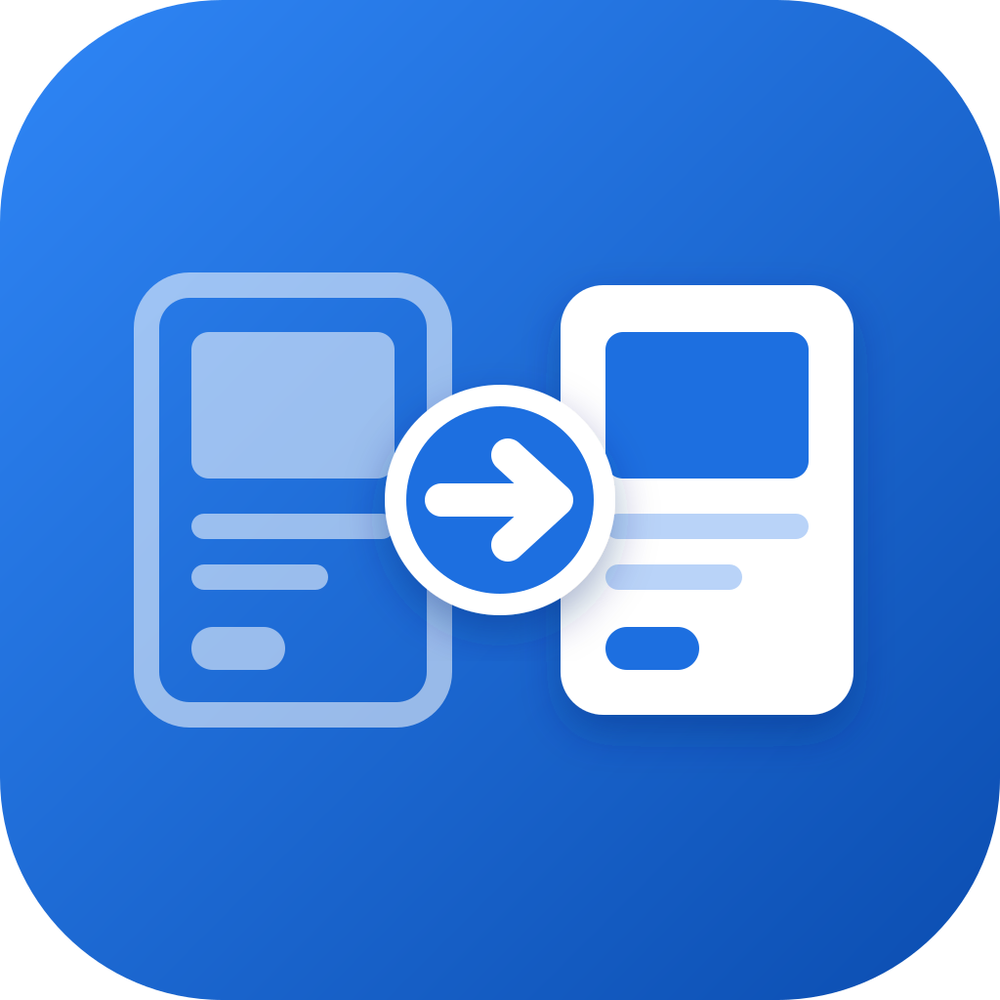

<p align="center">
  
</p>

<h1 align="center">Migra Ads</h1>

<p align="center">
  Migre campanhas, conjuntos e anúncios validados entre contas de anúncios da Meta em minutos.<br/>
  Local, gratuito e open source. Feito por <strong>Felipe Top</strong>:
  <a href="https://instagram.com/realfelipetop">Instagram</a> ·
  <a href="https://youtube.com/@realfelipetop">YouTube</a>
</p>

---

## Por que existe

Quando uma conta de anúncios cai ou entra em análise (muitas vezes por falha da própria plataforma), a operação para até alguém recriar tudo à mão em outra conta: campanhas, conjuntos, dezenas de anúncios, UTMs, pixel, lances. Isso leva horas.

O Migra Ads faz isso em minutos. Ele **reaproveita o post de cada anúncio** (curtidas e comentários vão junto) e cria tudo **pausado**, para você revisar e ativar quando quiser.

## O que ele faz

| | |
|---|---|
| **Conectar** | Login com Facebook usando um app da Meta que é só seu. Enxerga as mesmas contas e BMs do seu Gerenciador. |
| **Escolher** | Explorador no formato do Gerenciador (Campanhas / Conjuntos / Anúncios), com miniaturas, métricas do período, filtros e seleção em cascata. Funciona com conta **desativada**. |
| **Selecionar vencedores** | Marca de uma vez o que tem ROAS acima do mínimo que você escolher. |
| **Diagnóstico do destino** | Conta ativa, pagamento, moeda, fuso, limite de gastos, pixel, conversões, públicos, permissão na página. |
| **Mapear** | Destino em outra BM? Troque pixel, conversão, públicos e Instagram pelos de lá. Moeda diferente? Informe a conversão. Fica salvo para a próxima vez. |
| **Migrar** | Cria campanha → conjuntos → anúncios, **pausados**, com progresso ao vivo. Caiu a internet ou fechou o app? **Retome** sem duplicar nada. |
| **Multiplicar** | Escala horizontal: N cópias da campanha (`[C1]`, `[C2]`…) com os mesmos posts. |
| **Relatório** | O que foi criado, links diretos para o Gerenciador e o que precisa de ação manual. Exporta CSV. |
| **Backup automático** | Opcional. Guarda a estrutura (e, se quiser, as imagens e vídeos) das contas no seu computador. Dá para **migrar a partir de um backup** mesmo sem acesso à conta de origem. |
| **Utmify** | Opcional. Mostra lucro, ROAS e CPA reais da conta (API oficial da Utmify). |

### Limites conhecidos (sinceros)

- **Post multi-formato** (imagem recortada por posicionamento) não pode ser reaproveitado pela API da Meta. Esses anúncios aparecem como **"migrar manualmente"**, com o link do original.
- **Melhorias Advantage+ do criativo** podem ficar desligadas no destino: a Meta aceita o pedido, mas ignora esse campo pela API. Confira no Gerenciador antes de ativar.
- Tudo nasce com ID novo e passa de novo pela **fase de aprendizado**. O criativo migra, a performance não vem garantida.
- A **API da Utmify** só traz o resumo da conta (não por campanha), e hoje só funciona em alguns planos (beta).

## Requisitos

- **Node.js 20.9 ou mais novo**: [nodejs.org](https://nodejs.org) (versão LTS)
- **Git**: [git-scm.com](https://git-scm.com)
- macOS, Windows ou Linux
- Uma conta no Facebook com acesso às suas contas de anúncios

## Instalar e abrir

```bash
git clone https://github.com/<usuario>/migra-ads.git
cd migra-ads
npm install
npm start
```

Na primeira vez, o `npm start` prepara o app (cerca de 1 minuto) e abre o navegador em **http://localhost:3000**. Para fechar, aperte **Ctrl + C** no terminal. No **Windows**, use o PowerShell com os mesmos comandos.

Para atualizar depois: `git pull`, `npm install` e `npm start` (ele percebe que o código mudou e prepara de novo).

## Primeiro uso

1. Abra **Conexão** e siga o assistente: criar o seu app na Meta (10 minutos, uma vez só), colar o ID e a chave secreta, e **Entrar com Facebook**. Guia detalhado: [docs/conectar-meta.md](docs/conectar-meta.md).
   - O app fica em **modo de desenvolvimento**: só você usa, **sem publicar e sem análise da Meta**.
2. **Nova migração** → escolha a conta de origem → marque o que levar → **Continuar**.
3. Escolha o destino → **Revisar** → resolva o que estiver em vermelho → **Migrar agora**.
4. Abra a campanha nova no Gerenciador, confira e ative.

Dica: com uma **BM mãe** guardando pixel, página e domínio, quase toda migração vira o caso fácil. Veja a tela **Estrutura recomendada** no app.

## Perguntas frequentes

**É seguro?** Tudo roda no seu computador e o servidor só aceita conexões da própria máquina (`127.0.0.1`). O token da Meta e as chaves ficam criptografados na pasta `data/`, que nunca vai para o Git. Não existe servidor do Migra Ads nem telemetria. A criptografia protege contra vazamento acidental (print, backup, commit), não contra um vírus no seu computador.

**Preciso publicar o app na Meta?** Não. Em modo de desenvolvimento ele já migra reaproveitando os posts. Publicar só serviria para recriar criativos novos (posts multi-formato), e é opcional.

**A conexão expira?** O acesso aos dados vale cerca de 90 dias. O app avisa uma semana antes, e é só clicar em **Reconectar**.

**Posso usar para burlar restrição por política?** Não faça isso. Se a conta caiu por violação, corrija o anúncio antes: a Meta liga as contas pelo conteúdo, pela página e pelo domínio.

## Privacidade e termos

- [Política de Privacidade](docs/politica-de-privacidade.md)
- [Termos de Serviço](docs/termos-de-servico.md)

## Para quem desenvolve

| Comando | O que faz |
|---|---|
| `npm start` | Build (quando o código mudou) + servidor em `127.0.0.1:3000` + abre o navegador |
| `npm run dev` | Modo de desenvolvimento com recarga automática |
| `npm run check` | Lint + tipos + testes |
| `npm run smoke` | Sobe o app de verdade e confere as telas (o mesmo teste roda no CI em macOS, Windows e Linux) |
| `npm run db:generate` | Gera a migração SQL depois de alterar `src/db/schema.ts` |

**Stack:** Next.js 16, TypeScript, Tailwind CSS 4, shadcn/ui, SQLite (better-sqlite3 + Drizzle), TanStack Query, Vitest.

**Documentos:** [plano de implementação](PLANO_DE_IMPLEMENTACAO.md) · [resultados da Fase 0](docs/fase-0-resultados.md) (o que a API da Meta aceita e recusa) · [como contribuir](CONTRIBUTING.md) · [segurança](SECURITY.md) · [CLAUDE.md](CLAUDE.md) (contexto para o Claude Code).

## Licença

[MIT](LICENSE). Projeto independente, **sem ligação com a Meta Platforms, Inc.** "Meta", "Facebook" e "Instagram" são marcas da Meta Platforms, Inc.
